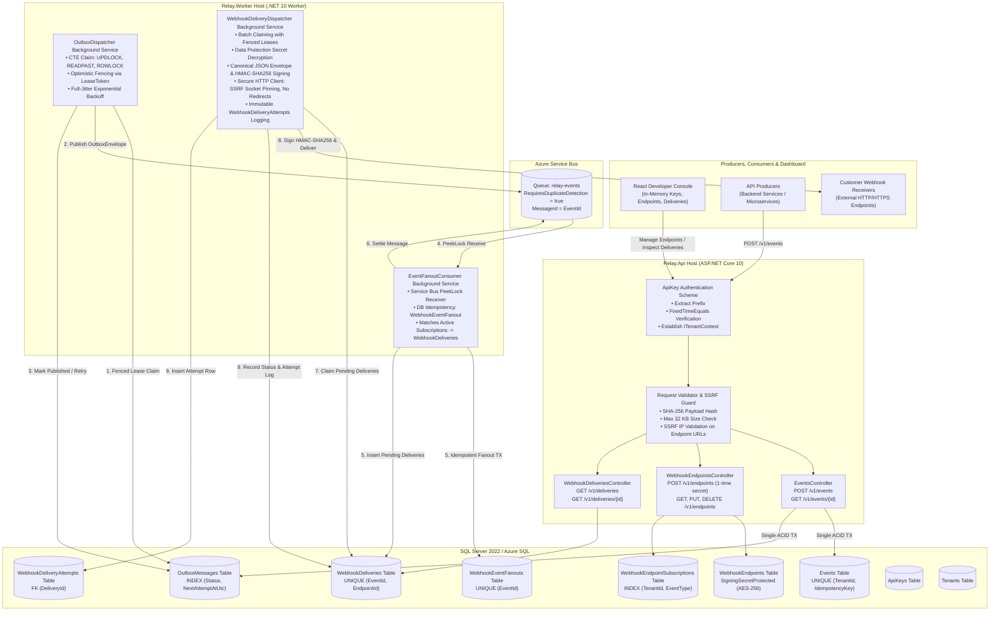
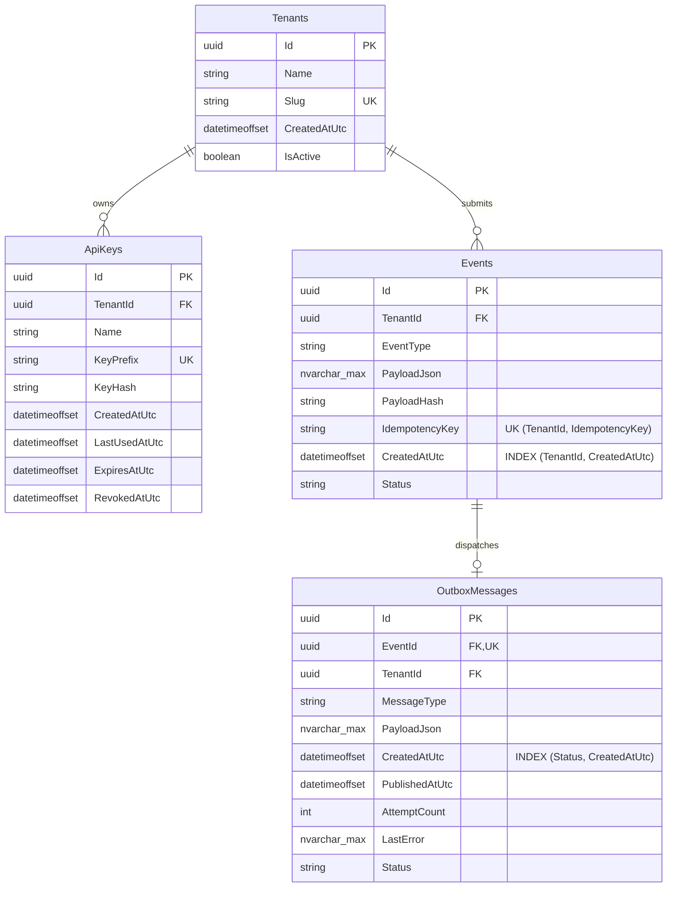
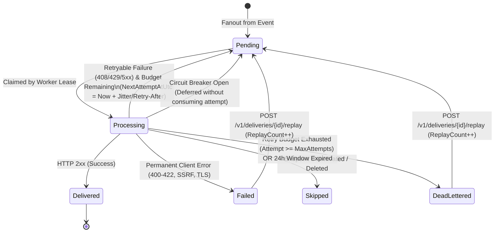

# RELAY

**Enterprise-Grade Multi-Tenant Webhook Delivery and Event Management Platform**

[](https://github.com/shouryasarkar/relay/actions)
[](LICENSE)
[](https://dotnet.microsoft.com/)
[](https://react.dev/)

---

## 1. What Relay Is

**Relay** is a multi-tenant, cloud-native webhook delivery and event management engine built with modern C#, ASP.NET Core, SQL Server, and React. External software applications integrate with Relay by submitting machine-to-machine business events (e.g., `order.created`, `payment.captured`, `invoice.paid`) via an authenticated, idempotent REST API. 

Relay durably persists these events into SQL Server within an atomic database transaction alongside a **Transactional Outbox** record, and dispatches them with guaranteed at-least-once delivery attempts to customer-registered webhook endpoints.

> [!IMPORTANT]
> **Delivery Semantics Invariant**: Relay does **not** claim impossible "exactly-once" delivery across distributed networks to arbitrary external HTTP destinations. Relay guarantees **durable acceptance** and **at-least-once delivery attempts**, backed by database-enforced idempotency, HMAC-SHA256 payload signing, and exponential-backoff retries. Downstream consumers are expected to implement idempotent webhook handlers.

---

## 2. The Problem Relay Solves

In modern SaaS applications, notifying third-party systems of events over HTTP is fraught with reliability hazards:
1. **Network Failures & Timeouts**: External customer endpoints frequently timeout, restart, or fail under burst load. Direct in-process HTTP dispatch blocks API threads and drops events on process crashes.
2. **The Dual-Write Problem**: Saving an event to a relational database and publishing it to a message broker (or sending an HTTP request) cannot be coordinated atomically without distributed transactions (2PC/XA), which are fragile and impair availability.
3. **Duplicate Submissions & Replays**: Mobile apps, web clients, and partner systems retry failed or timed-out requests. Without strict database-enforced idempotency, duplicates corrupt downstream financial or billing state.
4. **Cross-Tenant Data Leakage**: In multi-tenant environments, sloppy scoping can lead to security catastrophes where Tenant A inspects or receives events belonging to Tenant B.

Relay solves these issues by establishing a resilient, failure-oriented architecture with an atomic Transactional Outbox, constant-time API-key authentication, database-enforced idempotency, and strict tenant isolation.

---

## 3. Intended Users

1. **SaaS Platforms**: Applications needing to offer enterprise-grade webhooks to their customers with delivery logs, retries, and manual replay.
2. **Payment & Fintech Processors**: High-integrity systems requiring non-negotiable idempotency and cryptographic payload verification.
3. **Developer Platforms**: Engineering teams looking for a turnkey, reliable webhook ingestion and delivery pipeline without building brittle in-house cron jobs.

---

## 4. Key Capabilities

- **Multi-Tenant Event Ingestion**: High-throughput ingestion API with isolated tenant contexts.
- **Cryptographic API-Key Authentication**: Structured keys (`rl_live_<prefix>_<secret>`) verified using SHA-256 and constant-time comparison to defeat timing attacks.
- **Database-Enforced Idempotency**: Unique constraint on `(TenantId, IdempotencyKey)` guarantees safety against race conditions and duplicates.
- **Atomic Transactional Outbox**: `Event` and `OutboxMessage` persist within the exact same database transaction, eliminating dual-write data loss.
- **Tenant Data Isolation**: Database queries are strictly scoped by `TenantId`. Cross-tenant retrieval attempts safely return HTTP 404.
- **Inline Payload Guardrails**: Rejects payloads exceeding 32 KB with structured `HTTP 413 Payload Too Large` (Azure Blob Claim Check pattern planned for Phase 6).
- **Interactive Developer Console**: React 19 + TypeScript dashboard for testing ingestion, idempotency behavior, and inspecting event payloads with strictly in-memory credential storage.

---

## 5. Technology Stack

### Backend
- **Language / Runtime**: C# 13, .NET 10 LTS (SDK 10.0.404)
- **Framework**: ASP.NET Core 10 Web API
- **Persistence**: Entity Framework Core 10 (`Microsoft.EntityFrameworkCore.SqlServer` 10.0.15)
- **Database**: SQL Server 2022 (Local / Containers), Azure SQL Database (Cloud)
- **Authentication**: Custom ASP.NET Core `AuthenticationHandler` with `X-Api-Key`
- **Testing**: xUnit 2.9, FluentAssertions 8.0, `Microsoft.AspNetCore.Mvc.Testing`
- **Specification / Documentation**: OpenAPI (ASP.NET Core OpenAPI)

### Frontend
- **Framework**: React 19, TypeScript 5.7, Vite 6.2
- **Icons**: Lucide React
- **Design System**: Restrained, modern developer console with dark mode
- **Security**: Ephemeral React memory for API keys (never saved to `localStorage`, `sessionStorage`, or cookies)

---

## 6. High-Level Architecture



    subgraph Worker ["Relay.Worker Host (Background Dispatcher)"]
        DISP["OutboxDispatcher\n• Atomic CTE Claim (UPDLOCK, READPAST)\n• Lease Token & Expiration\n• Bounded Concurrency (Parallel.ForEachAsync)\n• Capped Jitter Exponential Backoff"]
        PUB["AzureServiceBusEventPublisher\n• IEventMessagePublisher Abstraction\n• Deterministic MessageId & CorrelationId\n• Native JSON Payload Envelope"]
    end

    subgraph Broker ["Azure Messaging"]
        SB[("Azure Service Bus\nTopic / Queue: relay-events\nBroker Deduplication Window")]
    end

    PROD -->|"POST /v1/events\nX-Api-Key, Idempotency-Key"| CTRL
    UI -->|"HTTP API Client"| CTRL
    CTRL --> AUTH
    AUTH --> VAL
    VAL --> INGEST
    INGEST --> TX
    TX --> T_EVT
    TX --> T_OUT
    T_KEY -.-> AUTH
    T_TEN -.-> AUTH
    CTRL --> QUERY
    QUERY --> T_EVT

    DISP -->|"1. Atomic Lease Claim (SQL)"| T_OUT
    DISP -->|"2. Network Publish (Outside SQL TX)"| PUB
    PUB -->|"3. AMQP 1.0 Send"| SB
    DISP -->|"4. Mark Published / Schedule Retry"| T_OUT
```

---

## 7. Project Structure

```text
Relay/
│
├── src/
│   ├── Relay.Domain/                   # Core domain entities, enums, rules (0 dependencies)
│   │   ├── Entities/                   # Tenant, ApiKey, Event, OutboxMessage
│   │   └── Enums/                      # EventStatus, OutboxStatus
│   │
│   ├── Relay.Application/              # Application services, DTOs, interfaces, validation
│   │   ├── Abstractions/               # IRelayDbContext, ITenantContext, IApiKeyHasher
│   │   ├── Common/                     # PayloadFingerprint (SHA-256 & size calculation)
│   │   ├── DTOs/                       # IngestEventRequest, IngestEventResponse, EventDto
│   │   ├── Exceptions/                 # IdempotencyConflictException, ValidationException
│   │   ├── Services/                   # EventIngestionService, EventQueryService
│   │   └── Validators/                 # IngestEventValidator
│   │
│   ├── Relay.Infrastructure/           # EF Core DbContext, migrations, configurations, hashing
│   │   ├── Configurations/             # Fluent API entity mappings & unique indexes
│   │   ├── Data/                       # DbInitializer (seed development tenant)
│   │   ├── Migrations/                 # EF Core version-controlled C# migrations
│   │   ├── Services/                   # ApiKeyHasher (SHA-256 + constant-time comparison)
│   │   └── RelayDbContext.cs
│   │
│   ├── Relay.Api/                      # ASP.NET Core Web API host
│   │   ├── Authentication/             # ApiKeyAuthenticationHandler & options
│   │   ├── Controllers/                # EventsController, HealthController
│   │   ├── Middleware/                 # ExceptionHandlingMiddleware (ProblemDetails)
│   │   ├── Services/                   # TenantContext (ClaimsPrincipal provider)
│   │   └── Program.cs
│   │
│   └── Relay.Worker/                   # Background worker service host (Phase 2 dispatcher)
│
├── frontend/
│   └── relay-dashboard/                # React 19 + TypeScript + Vite developer console
│       ├── src/
│       │   ├── api/                    # Typed RelayApiClient with ProblemDetails handling
│       │   ├── components/             # Sidebar, Header, Overview, Playground, EventsView
│       │   ├── types/                  # TypeScript API contracts mirroring backend DTOs
│       │   └── App.tsx
│       └── package.json
│
├── tests/
│   ├── Relay.UnitTests/                # 39 focused unit tests (Validation, Hashing, Entities)
│   └── Relay.IntegrationTests/         # 13 integration tests (WebApplicationFactory + SQL Server)
│
├── docs/
│   ├── architecture/                   # System overview & architectural summaries
│   └── adr/                            # Architecture Decision Records (ADRs 0001 - 0005)
│
├── scripts/                            # Operational shell scripts
│   ├── start-db.sh                     # Starts local SQL Server via Docker Compose / Podman
│   ├── stop-db.sh                      # Stops local SQL Server container
│   ├── migrate.sh                      # Applies EF Core database migrations
│   ├── run-api.sh                      # Starts ASP.NET Core API
│   └── run-frontend.sh                 # Starts React developer console
│
├── docker-compose.yml                  # SQL Server 2022 service definition
├── Directory.Build.props               # Central MSBuild properties (net10.0, nullable enabled)
├── Directory.Packages.props            # Central Package Management (CPM)
├── .editorconfig                       # Formatting and code style enforcement
├── .gitignore
├── Relay.sln
└── README.md
```

---

## 8. Database Entities and Relationships



### Critical Indexes & Constraints

1. **`IX_Events_TenantId_IdempotencyKey`**:
   `UNIQUE (TenantId, IdempotencyKey)` on `Events`. Enforces idempotency at the database engine level, preventing race conditions that application pre-checks cannot catch.
2. **`IX_ApiKeys_KeyPrefix`**:
   `UNIQUE (KeyPrefix)` on `ApiKeys`. Allows $O(1)$ key lookup by public prefix without scanning the table.
3. **`IX_Events_TenantId_CreatedAtUtc`**:
   Compound index on `(TenantId, CreatedAtUtc)` for efficient tenant history sorting.
4. **`IX_OutboxMessages_Status_CreatedAtUtc`**:
   Compound index on `(Status, CreatedAtUtc)` for future background outbox polling.

---

## 9. Authentication Design

Relay utilizes custom machine-to-machine API-key authentication:

```http
X-Api-Key: rl_live_<prefix>_<secret>
```

- `rl_live_`: Environment indicator (`live` or `test`).
- `<prefix>`: Public identifier (e.g. `pk_dev001`) indexed uniquely in SQL Server.
- `<secret>`: 256-bit cryptographically secure random token generated via `RandomNumberGenerator`.

### Verification Steps
1. Scheme extracts `prefix` and `secret`.
2. O(1) query retrieves the key matching `KeyPrefix = @prefix`.
3. Secret is hashed using SHA-256.
4. `CryptographicOperations.FixedTimeEquals` verifies the hash in constant time, preventing side-channel timing attacks.
5. Inactive tenant, revoked key, or expired key returns `HTTP 401 Unauthorized` without revealing the specific failure reason.
6. On success, `ITenantContext` is populated with `TenantId` and `ApiKeyId`.

---

## 10. Idempotency Behavior

| Scenario | Incoming Request | Result | Database Invariant |
| :--- | :--- | :--- | :--- |
| **New Event** | New `Idempotency-Key` | `HTTP 202 Accepted` | 1 Event, 1 OutboxMessage inserted |
| **Identical Duplicate** | Existing `Idempotency-Key` + Identical Payload | `HTTP 202 Accepted` (Replay) | Replays original Event ID; no new records created |
| **Content Conflict** | Existing `Idempotency-Key` + Different Payload | `HTTP 409 Conflict` | Throws `IdempotencyConflictException`; no records created |
| **Concurrent Race** | Simultaneous duplicate requests | `HTTP 202 Accepted` | Handled via `DbUpdateException` catch; exactly 1 record persists |

---

## 11. Transactional Outbox Implementation

When an event is ingested:

```text
BEGIN TRANSACTION
    INSERT INTO Events (...) VALUES (...)
    INSERT INTO OutboxMessages (Status = 'Pending', ...) VALUES (...)
COMMIT TRANSACTION
```

If the database transaction rolls back, **neither** record is saved, and `HTTP 202` is never returned. Once committed, the outbox record stands as a durable guarantee that Phase 2 workers will dispatch the event.

---

## 12. REST API Specification

### A. Ingest Event
```http
POST /v1/events
Content-Type: application/json
X-Api-Key: <your-api-key>
Idempotency-Key: idem_order_1001

{
  "eventType": "order.created",
  "payload": {
    "orderId": "ORD-1001",
    "amount": 1499.00,
    "currency": "INR"
  }
}
```

**Response: `HTTP 202 Accepted`**
```http
Location: /v1/events/4a3f2b1c-8e9d-4f5a-b6c7-d8e9f0123456
Content-Type: application/json

{
  "eventId": "4a3f2b1c-8e9d-4f5a-b6c7-d8e9f0123456",
  "status": "Accepted",
  "createdAtUtc": "2026-11-17T06:30:00Z"
}
```

### B. Get Event by ID
```http
GET /v1/events/4a3f2b1c-8e9d-4f5a-b6c7-d8e9f0123456
X-Api-Key: rl_live_pk_dev001_...
```

**Response: `HTTP 200 OK`**
```json
{
  "id": "4a3f2b1c-8e9d-4f5a-b6c7-d8e9f0123456",
  "tenantId": "f7d2e1b0-4c3a-4b5d-9e8f-0123456789ab",
  "eventType": "order.created",
  "payloadJson": "{\"orderId\":\"ORD-1001\",\"amount\":1499,\"currency\":\"INR\"}",
  "payloadHash": "e3b0c44298fc1c149afbf4c8996fb92427ae41e4649b934ca495991b7852b855",
  "idempotencyKey": "idem_order_1001",
  "createdAtUtc": "2026-11-17T06:30:00Z",
  "status": "Accepted"
}
```

### C. List Tenant Events
```http
GET /v1/events?take=20
X-Api-Key: rl_live_pk_dev001_...
```

**Response: `HTTP 200 OK`**
```json
{
  "items": [ ... ],
  "count": 1,
  "take": 20
}
```

### D. Health Endpoints
- `GET /health/live` -> `{"status":"Live","timestampUtc":"..."}` (200 OK)
- `GET /health/ready` -> `{"status":"Ready","database":"Connected","timestampUtc":"..."}` (200 OK or 503 Unavailable)

---

## 13. Local Setup and Development

### Prerequisites
- .NET 10 SDK (`dotnet --version` >= 10.0.100)
- Node.js (>= 20) and npm (>= 10)
- Docker or Podman for local SQL Server

### Quickstart Commands

```bash
# 1. Start local SQL Server 2022 container on port 1433
./scripts/start-db.sh

# 2. Apply EF Core database migrations
./scripts/migrate.sh

# 3. Start ASP.NET Core API on http://localhost:5000
./scripts/run-api.sh

# 4. In a separate terminal, start the React Developer Console on http://localhost:5173
./scripts/run-frontend.sh
```

Open `http://localhost:5173` in your browser. When the API starts up in Development environment, it seeds an active development tenant and outputs the generated API key to the console log.

---

## 14. Testing

### Run Unit Tests
```bash
dotnet test tests/Relay.UnitTests/Relay.UnitTests.csproj
```
Results: **74 Passed / 74 Total (100%)**

### Run Integration Tests
```bash
# Requires SQL Server running on port 1433 and Azure Service Bus Emulator on port 5672
dotnet test tests/Relay.IntegrationTests/Relay.IntegrationTests.csproj
```
Results: **34 Passed / 34 Total (100%)**

### Run Frontend Typecheck & Build
```bash
cd frontend/relay-dashboard
npm run lint
npm run build
```

---

## 15. Phase 2.1 — Reliability Verification

### A. Broker Integration Status
The asynchronous publishing pipeline has been verified with genuine end-to-end integration tests using the official **Azure Service Bus Emulator** container (`mcr.microsoft.com/azure-messaging/servicebus-emulator:latest`) paired with SQL Server 2022 on Linux/Podman:
- **Queue Verified**: `relay-events`
- **RequiresDuplicateDetection**: `true`
- **DuplicateDetectionHistoryTimeWindow**: `PT5M` (5 minutes)
- **Send and Receive Verified**: Outbox records were claimed, published via the official `Azure.Messaging.ServiceBus` SDK, retrieved with a receiver client, and verified to have preserved unescaped native JSON payload structures.
- **Broker Deduplication Verified**: Sending two identical `MessageId` messages within the 5-minute detection window resulted in the emulator suppressing the duplicate message, delivering exactly 1 message to the receiver.

### B. How to Configure and Run Broker Tests
1. **Local Emulator (Container)**:
   ```bash
   podman run -d --name relay-servicebus-emulator --network host \
     -e ACCEPT_EULA=Y \
     -e SQL_SERVER=127.0.0.1 \
     -e MSSQL_SA_PASSWORD='Your_Strong_Password123!' \
     -v ./emulator/Config.json:/ServiceBus_Emulator/ConfigFiles/Config.json:Z \
     mcr.microsoft.com/azure-messaging/servicebus-emulator:latest
   ```
2. **Optional Real Azure Namespace**:
   Export your Azure Service Bus connection string or managed identity namespace:
   ```bash
   export RELAY_SERVICEBUS_CONNECTION_STRING="Endpoint=sb://<your-namespace>.servicebus.windows.net/;..."
   dotnet test tests/Relay.IntegrationTests/Relay.IntegrationTests.csproj --filter "FullyQualifiedName~AzureServiceBusBrokerIntegrationTests"
   ```

### C. Simulation vs Production Publisher Safety
The diagnostic logging publisher (`SimulationDiagnosticPublisher`) is quarantined for development only. It requires explicit opt-in (`ServiceBus:AllowSimulationPublisher=true`) in the `Development` environment. In production, startup immediately throws an `InvalidOperationException` if valid Azure Service Bus credentials or fully qualified namespace are not configured, preventing silent data loss or fake deliveries.

### D. System Guarantees & Known Boundaries
- **Guaranteed**: At-least-once durable event acceptance into SQL Server. Valid events committed to SQL Server will never be dropped by broker outages.
- **Guaranteed**: Clean non-blocking concurrent batch claiming across horizontal worker replicas via `UPDLOCK, READPAST, ROWLOCK, READCOMMITTEDLOCK`.
- **Guaranteed**: Optimistic fencing via unique `LeaseToken` preventing stale workers from overwriting active claims after lease expiration.
- **Guaranteed**: Distinct `ClaimCount` (lease acquisitions) and `PublishAttemptCount` (actual network dispatch attempts).
- **Not Guaranteed**: Eternal broker-side deduplication. Azure Service Bus duplicate detection only applies within the configured detection window (e.g. 5 minutes up to 7 days).
- **Not Guaranteed**: Exactly-once delivery to arbitrary external HTTP webhooks. Relay guarantees at-least-once delivery; downstream consumers must be idempotent.

---

## 16. Phase 3 — Webhook Delivery Engine, HMAC Signing & SSRF Defense

Phase 3 transitions Relay from an event publishing engine into an enterprise webhook delivery infrastructure platform:

### A. Webhook Endpoint Management & Signing Secrets
- **Endpoints API**: `POST /v1/endpoints`, `GET /v1/endpoints`, `GET /v1/endpoints/{id}`, `PUT /v1/endpoints/{id}`, `DELETE /v1/endpoints/{id}`.
- **Tenant Isolation**: Every endpoint query is strictly scoped to the authenticated tenant. Cross-tenant access returns 404.
- **One-Time Secret Exposure**: A cryptographically random signing secret (`whsec_<hex>`) is returned exactly once during endpoint creation.
- **Secret Encryption at Rest**: Secrets are encrypted at rest using AES-256 via ASP.NET Core Data Protection (`IDataProtectionProvider`), pinned to `Relay.Platform`.

### B. Durable Event Fan-Out
- Background Service Bus consumer (`EventFanoutConsumer`) receives events under `PeekLock` semantics.
- Matches active tenant subscriptions using normalized `WebhookEndpointSubscription` queries.
- Idempotency is guaranteed by `WebhookEventFanout` (unique on `EventId`) and `WebhookDelivery` (unique on `EventId, EndpointId`).
- Settles broker messages (`CompleteMessageAsync`) only after the fan-out transaction commits.

### C. Webhook Delivery Dispatcher
- Background delivery service (`WebhookDeliveryDispatcher`) claims pending deliveries using lease-based atomic CTE queries (`UPDLOCK, READPAST, ROWLOCK`).
- Constructs a canonical JSON delivery envelope:
  ```json
  {
    "schemaVersion": 1,
    "eventId": "3fa85f64-5717-4562-b3fc-2c963f66afa6",
    "eventType": "invoice.paid",
    "occurredAtUtc": "2026-11-17T03:00:00Z",
    "payload": { "invoiceId": "INV-101", "amount": 500 }
  }
  ```
- Computes canonical HMAC-SHA256 signature and includes standard headers:
  - `X-Relay-Event-Id`: GUID of the event
  - `X-Relay-Delivery-Id`: GUID of the delivery
  - `X-Relay-Attempt`: Attempt counter (1-based)
  - `X-Relay-Timestamp`: Unix epoch timestamp in seconds
  - `X-Relay-Signature`: `t=<timestamp>,v1=<hex_hmac_sha256>`
- Records status (`Delivered`, `Failed`, `Skipped`) and appends immutable `WebhookDeliveryAttempt` audit records with latency and response excerpts.

### D. Multi-Layer SSRF Protection
- **Registration Validation**: Blocks loopback (`127.0.0.0/8`, `::1`), private networks (`10.0.0.0/8`, `172.16.0.0/12`, `192.168.0.0/16`), link-local/cloud metadata (`169.254.169.254`), and IPv6-mapped IPv4.
- **DNS Rebinding Defense (TOCTOU)**: Custom `SocketsHttpHandler.ConnectCallback` validates resolved IPs immediately prior to socket creation and pins the TCP socket to the validated IP.
- **Hardened HTTP Client**: Automatic redirects disabled (`AllowAutoRedirect = false`), 10-second timeout, and 4 KB response read limits.

---

## 17. Phase 4 — Intelligent Retry Engine, Dead-Letter Recovery & Resilience

Phase 4 elevates Relay's webhook delivery system into an enterprise resilience platform capable of self-healing, rate-limit adherence, failure isolation, and manual operational recovery:

### A. Failure Classification & Durable Full Jitter Retry Engine
- **Failure Classification (`IWebhookDeliveryFailureClassifier`)**:
  - Distinguishes permanent failures (`400-422`, `3xx`, SSRF blocks, TLS cert errors) from transient failures (`408`, `425`, `429`, `5xx`, socket resets/timeouts).
  - Permanent client errors fail fast (`Status = Failed`) without wasting retry attempts or worker resources.
- **Durable Full Jitter Exponential Backoff (`IWebhookRetryPolicy`)**:
  - `ExponentialCap = min(MaxDelaySeconds, BaseDelaySeconds * 2^(attempt - 1))`.
  - `Delay = UniformRandom(0, ExponentialCap)`. Full Jitter ensures uniform distribution across time, preventing synchronized thundering herd spikes.
  - Retries are scheduled durably in SQL Server via `NextAttemptAtUtc`—never in-memory `Task.Delay`.
- **24-Hour Bounded Window**: Retries are rejected and dead-lettered if `NextAttemptAtUtc > CreatedAtUtc + MaxRetryWindowHours` (default 24h).
- **Strict Separation of Claim vs Attempt**: Claiming records increments `ClaimCount`; `AttemptCount` is strictly incremented only upon actual outbound HTTP dispatch.

### B. Standards-Compliant `Retry-After` Handling
- **RFC 7231 / RFC 9110 Support (`IRetryAfterParser`)**:
  - Parses delta-seconds (`Retry-After: 120`) and RFC1123 HTTP-date (`Retry-After: Wed, 21 Oct 2026 07:28:00 GMT`).
  - Strict UTC timestamp conversion and clamping against `MaxServerRequestedDelaySeconds` (default 86,400s / 24h).
  - Guarantees Relay never retries earlier than the server requested: `Delay = max(CalculatedJitterDelay, ServerRequestedDelay)`.
  - Distinguishes cooperative rate limits (`429`) from service crashes (`500/503`): `429` does not trip circuit breakers.

### C. Dead-Letter Management & Manual Replay API
- **Dead-Letter State (`WebhookDeliveryStatus.DeadLettered`)**:
  - Deliveries reaching max attempts (default 8), exceeding the 24-hour window, or receiving excessive server delay requests are quarantined into `DeadLettered` status.
  - Automatically skipped by background dispatcher queries to prevent queue clogging.
- **Manual Replay API (`POST /v1/deliveries/{deliveryId}/replay`)**:
  - Tenant-authorized endpoint allowing replay of `DeadLettered` or `Failed` deliveries.
  - Validates that the target endpoint is active before replaying.
  - Optional `Idempotency-Key` header prevents duplicate replays.
  - Inserts durable audit log (`WebhookDeliveryReplayAudit`) with `TenantId`, `ReplayKey`, `RequestedBy`, `PreviousStatus`, and `ReplayedAtUtc`.
  - Resets delivery status to `Pending` and increments `ReplayCount` while **strictly preserving** the stable `DeliveryId` and entire historical attempt timeline.

### D. Endpoint-Level Circuit Breakers & Concurrency Bulkheads
- **Shared SQL Server Circuit Breakers (`IEndpointCircuitBreakerManager`)**:
  - Tracks state directly on `WebhookEndpoint` in SQL Server: `Closed`, `Open`, `HalfOpen`.
  - Trips to `Open` when consecutive failures reach `FailureThreshold` (default 5).
  - Transitions to `HalfOpen` after `OpenDurationSeconds` (default 60s).
  - Enforces a **single half-open probe** (`TryAcquireHalfOpenProbe`), preventing thundering herds from overwhelming recovering endpoints.
  - **Zero Budget Penalty**: Deferred deliveries remain `Pending` and do not consume tenant retry attempts.
- **Dual-Level Concurrency Bulkheads (`IBulkheadManager`)**:
  - **Global Worker Concurrency**: Limits total outbound HTTP connections (default 20) across all endpoints.
  - **Per-Endpoint Concurrency**: Limits concurrent connections to any single endpoint (default 5).
  - Prevents slow/unresponsive endpoints from monopolizing worker threads or starving healthy endpoints.

### E. Delivery State Machine



---

## 18. Implementation Status & Roadmap

| Feature / Component | Status | Target Phase |
| :--- | :--- | :--- |
| Modular Monolith Architecture & Project Structure | **Implemented & Tested** | Phase 0 |
| C# Domain Entities & Value Primitives | **Implemented & Tested** | Phase 1 |
| EF Core 10 DbContext, Unique Indexes & Migrations | **Implemented & Tested** | Phase 1 |
| API-Key Scheme with Constant-Time Hashing | **Implemented & Tested** | Phase 1 |
| Idempotent Event Ingestion (`POST /v1/events`) | **Implemented & Tested** | Phase 1 |
| Atomic Transactional Outbox Insertion | **Implemented & Tested** | Phase 1 |
| Tenant-Scoped Retrieval & Listing (`GET /v1/events`) | **Implemented & Tested** | Phase 1 |
| Health Endpoints (`/health/live`, `/health/ready`) | **Implemented & Tested** | Phase 1 |
| React 19 + TypeScript Developer Console | **Implemented & Tested** | Phase 1 |
| GitHub Actions CI Workflow | **Implemented** | Phase 1 |
| Outbox Dispatcher with Lease-Based Atomic Claiming | **Implemented & Tested** | Phase 2 |
| Azure Service Bus Publisher & Envelope Serialization | **Implemented & Tested** | Phase 2 |
| Full Jitter Exponential Backoff & Transient Retry Logic | **Implemented & Tested** | Phase 2 |
| Real Azure Service Bus Emulator Verification & Deduplication | **Implemented & Tested** | Phase 2.1 |
| ClaimCount vs PublishAttemptCount Separation | **Implemented & Tested** | Phase 2.1 |
| RCSI & READCOMMITTEDLOCK Concurrency Hardening | **Implemented & Tested** | Phase 2.1 |
| Multi-Tenant Webhook Endpoint Registration & Subscriptions | **Implemented & Tested** | Phase 3 |
| One-Time Signing Secret Generation & Data Protection at Rest | **Implemented & Tested** | Phase 3 |
| Durable Event Fan-Out Consumer with DB Idempotency | **Implemented & Tested** | Phase 3 |
| Webhook Delivery Dispatcher with Lease Claiming & HMAC Signing | **Implemented & Tested** | Phase 3 |
| Comprehensive SSRF Defense & DNS Rebinding Socket Pinning | **Implemented & Tested** | Phase 3 |
| Delivery History Inspection API (`GET /v1/deliveries`) | **Implemented & Tested** | Phase 3 |
| React Dashboard Endpoints & Deliveries Management Views | **Implemented & Tested** | Phase 3 |
| Full Jitter Exponential Webhook Retry Policy (24h Window) | **Implemented & Tested** | Phase 4 |
| Standards-Compliant `Retry-After` Header Parsing | **Implemented & Tested** | Phase 4 |
| Dead-Letter Queue & Isolation (`DeadLettered` Status) | **Implemented & Tested** | Phase 4 |
| Manual Replay API (`POST /v1/deliveries/{id}/replay`) & Auditing | **Implemented & Tested** | Phase 4 |
| Shared SQL-Backed Circuit Breakers (Closed/Open/HalfOpen) | **Implemented & Tested** | Phase 4 |
| Dual-Level Concurrency Bulkheads (Global & Per-Endpoint) | **Implemented & Tested** | Phase 4 |
| Dashboard Dead-Letter Filtering, Timeline & Replay UI | **Implemented & Tested** | Phase 4 |
| Bulkhead Inverted Admission Control & Semaphore Sweeping | **Implemented & Tested** | Phase 4.1 |
| Circuit Breaker Probe Leases & Crash Recovery | **Implemented & Tested** | Phase 4.1 |
| Replay Retry-Cycle Isolation & Scoped Idempotency | **Implemented & Tested** | Phase 4.1 |
| Azure Infrastructure Deployment (Bicep + ACA) | **Stage A Ready** (IaC, Docker, CI/CD, Admin CLI) | Phase 5 |
| Dedicated Migration & Tenant Management CLI (`relay-admin`) | **Implemented & Tested** | Phase 5 |
| OpenTelemetry Distributed Tracing & Azure Monitor | **Implemented & Configured** | Phase 5 |
| Azure Blob Storage & Key Vault Data Protection Ring | **Implemented & Integrated** | Phase 5 |
| Azure Cloud Live Deployment Execution | *Pending User Approval (Stage B)* | Phase 5 |
| Azure Blob Claim Check for Large Payloads (>32KB) | *Planned* | Phase 6 |

---

## 19. Architecture Decision Records (ADRs)

| ADR | Title | Status | Date |
| :--- | :--- | :--- | :--- |
| [0001](docs/adr/0001-project-architecture.md) | Project Architecture & Modular Monolith Design | Accepted | 2026-11-17 |
| [0002](docs/adr/0002-database-choice.md) | Database Choice: SQL Server / Azure SQL Database | Accepted | 2026-11-17 |
| [0003](docs/adr/0003-api-key-authentication.md) | API-Key Authentication & Constant-Time Hashing | Accepted | 2026-11-17 |
| [0004](docs/adr/0004-transactional-outbox.md) | Atomic Transactional Outbox Pattern | Accepted | 2026-11-17 |
| [0005](docs/adr/0005-react-frontend.md) | React 19 Frontend Developer Console | Accepted | 2026-11-17 |
| [0006](docs/adr/0006-outbox-dispatcher-and-lease-based-claiming.md) | Outbox Dispatcher and Lease-Based Claiming | Accepted | 2026-11-17 |
| [0007](docs/adr/0007-azure-service-bus-integration.md) | Azure Service Bus Integration & Message Envelope | Accepted | 2026-11-17 |
| [0008](docs/adr/0008-webhook-endpoint-management-and-subscription-model.md) | Webhook Endpoint Management & Subscription Model | Accepted | 2026-11-17 |
| [0009](docs/adr/0009-durable-event-fan-out-and-consumer-idempotency.md) | Durable Event Fan-Out & Consumer Idempotency | Accepted | 2026-11-17 |
| [0010](docs/adr/0010-webhook-signing-and-endpoint-secret-protection.md) | Webhook HMAC-SHA256 Signing & Secret Protection | Accepted | 2026-11-17 |
| [0011](docs/adr/0011-ssrf-protection-and-secure-outbound-http.md) | Multi-Layer SSRF Defense & Socket Pinning | Accepted | 2026-11-17 |
| [0012](docs/adr/0012-durable-webhook-retry-policy-and-http-failure-classification.md) | Durable Retry Policy & HTTP Failure Classification | Accepted | 2026-11-17 |
| [0013](docs/adr/0013-retry-after-handling-and-server-directed-retry-scheduling.md) | Retry-After Handling & Server-Directed Scheduling | Accepted | 2026-11-17 |
| [0014](docs/adr/0014-delivery-dead-letter-management-and-manual-replay.md) | Webhook Delivery Dead-Letter Management & Replay | Accepted | 2026-11-17 |
| [0015](docs/adr/0015-endpoint-level-circuit-breakers-and-concurrency-bulkheads.md) | Endpoint Circuit Breakers & Concurrency Bulkheads | Accepted | 2026-11-17 |
| [0016](docs/adr/0016-bulkhead-admission-control-and-noisy-neighbor-prevention.md) | Bulkhead Admission Control & Noisy-Neighbor Prevention | Accepted | 2026-11-17 |
| [0017](docs/adr/0017-circuit-breaker-probe-leases-and-crash-recovery.md) | Circuit Breaker Probe Leases & Crash Recovery | Accepted | 2026-11-17 |
| [0018](docs/adr/0018-manual-replay-retry-cycle-semantics.md) | Manual Replay Retry-Cycle Semantics & Idempotency Scope | Accepted | 2026-11-17 |
| [0019](docs/adr/0019-azure-container-apps-hosting.md) | Azure Container Apps for API and Worker Hosting | Accepted | 2026-11-17 |
| [0020](docs/adr/0020-managed-identity-and-passwordless-access.md) | Managed Identity & Passwordless Access | Accepted | 2026-11-17 |
| [0021](docs/adr/0021-azure-data-protection-key-storage.md) | Distributed ASP.NET Core Data Protection Key Ring | Accepted | 2026-11-17 |
| [0022](docs/adr/0022-azure-networking-and-egress.md) | Azure Networking, Ingress, and Outbound Egress | Accepted | 2026-11-17 |
| [0023](docs/adr/0023-observability-and-distributed-tracing.md) | Observability, Distributed Tracing & Azure Monitor | Accepted | 2026-11-17 |
| [0024](docs/adr/0024-database-migration-deployment-strategy.md) | Database Migration & Operational Tooling Strategy | Accepted | 2026-11-17 |

---

## 20. Automated Test Suite Metrics

```text
========================================================================================
Test Suite               Passed    Failed    Skipped    Duration
========================================================================================
Relay.UnitTests             137         0          0    ~120 ms
Relay.IntegrationTests       45         0          0    ~6.5 s
React Frontend (Lint)      Pass         0          0    ~1.8 s
React Frontend (Build)     Pass         0          0    ~1.2 s
----------------------------------------------------------------------------------------
Total Automated Tests       182         0          0    Fully Verified
========================================================================================
```

---

## 21. License

This project is licensed under the MIT License.
