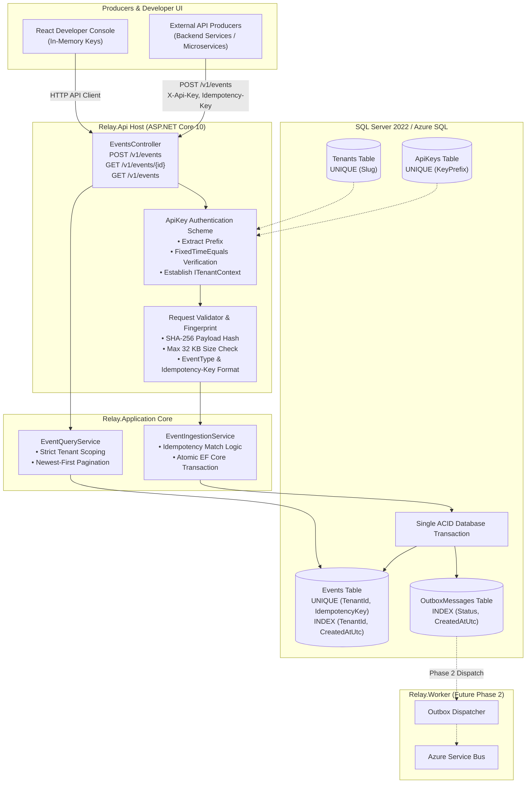
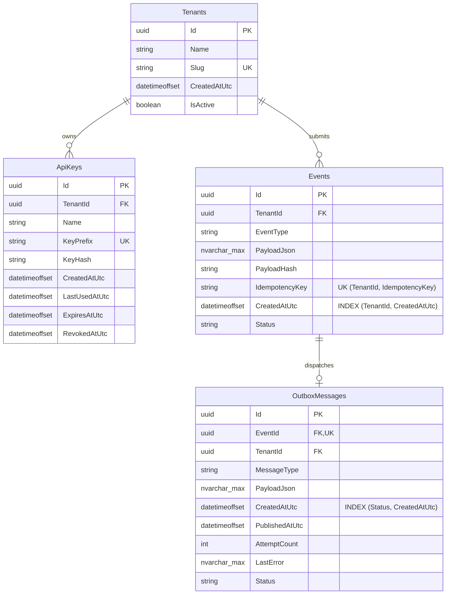

# RELAY

**Enterprise-Grade Multi-Tenant Webhook Delivery and Event Management Platform**

[](https://github.com/shouryasarkar/relay/actions)
[](LICENSE)
[](https://dotnet.microsoft.com/)
[](https://react.dev/)

---

## 1. What Relay Is

**Relay** is a multi-tenant, cloud-native webhook delivery and event management engine built with modern C#, ASP.NET Core, SQL Server, and React. External software applications integrate with Relay by submitting machine-to-machine business events (e.g., `order.created`, `payment.captured`, `invoice.paid`) via an authenticated, idempotent REST API. 

Relay durably persists these events into SQL Server within an atomic database transaction alongside a **Transactional Outbox** record, and dispatches them with guaranteed at-least-once delivery attempts to customer-registered webhook endpoints.

> [!IMPORTANT]
> **Delivery Semantics Invariant**: Relay does **not** claim impossible "exactly-once" delivery across distributed networks to arbitrary external HTTP destinations. Relay guarantees **durable acceptance** and **at-least-once delivery attempts**, backed by database-enforced idempotency, HMAC-SHA256 payload signing, and exponential-backoff retries. Downstream consumers are expected to implement idempotent webhook handlers.

---

## 2. The Problem Relay Solves

In modern SaaS applications, notifying third-party systems of events over HTTP is fraught with reliability hazards:
1. **Network Failures & Timeouts**: External customer endpoints frequently timeout, restart, or fail under burst load. Direct in-process HTTP dispatch blocks API threads and drops events on process crashes.
2. **The Dual-Write Problem**: Saving an event to a relational database and publishing it to a message broker (or sending an HTTP request) cannot be coordinated atomically without distributed transactions (2PC/XA), which are fragile and impair availability.
3. **Duplicate Submissions & Replays**: Mobile apps, web clients, and partner systems retry failed or timed-out requests. Without strict database-enforced idempotency, duplicates corrupt downstream financial or billing state.
4. **Cross-Tenant Data Leakage**: In multi-tenant environments, sloppy scoping can lead to security catastrophes where Tenant A inspects or receives events belonging to Tenant B.

Relay solves these issues by establishing a resilient, failure-oriented architecture with an atomic Transactional Outbox, constant-time API-key authentication, database-enforced idempotency, and strict tenant isolation.

---

## 3. Intended Users

1. **SaaS Platforms**: Applications needing to offer enterprise-grade webhooks to their customers with delivery logs, retries, and manual replay.
2. **Payment & Fintech Processors**: High-integrity systems requiring non-negotiable idempotency and cryptographic payload verification.
3. **Developer Platforms**: Engineering teams looking for a turnkey, reliable webhook ingestion and delivery pipeline without building brittle in-house cron jobs.

---

## 4. Key Capabilities

- **Multi-Tenant Event Ingestion**: High-throughput ingestion API with isolated tenant contexts.
- **Cryptographic API-Key Authentication**: Structured keys (`rl_live_<prefix>_<secret>`) verified using SHA-256 and constant-time comparison to defeat timing attacks.
- **Database-Enforced Idempotency**: Unique constraint on `(TenantId, IdempotencyKey)` guarantees safety against race conditions and duplicates.
- **Atomic Transactional Outbox**: `Event` and `OutboxMessage` persist within the exact same database transaction, eliminating dual-write data loss.
- **Tenant Data Isolation**: Database queries are strictly scoped by `TenantId`. Cross-tenant retrieval attempts safely return HTTP 404.
- **Inline Payload Guardrails**: Rejects payloads exceeding 32 KB with structured `HTTP 413 Payload Too Large` (Azure Blob Claim Check pattern planned for Phase 6).
- **Interactive Developer Console**: React 19 + TypeScript dashboard for testing ingestion, idempotency behavior, and inspecting event payloads with strictly in-memory credential storage.

---

## 5. Technology Stack

### Backend
- **Language / Runtime**: C# 13, .NET 10 LTS (SDK 10.0.404)
- **Framework**: ASP.NET Core 10 Web API
- **Persistence**: Entity Framework Core 10 (`Microsoft.EntityFrameworkCore.SqlServer` 10.0.15)
- **Database**: SQL Server 2022 (Local / Containers), Azure SQL Database (Cloud)
- **Authentication**: Custom ASP.NET Core `AuthenticationHandler` with `X-Api-Key`
- **Testing**: xUnit 2.9, FluentAssertions 8.0, `Microsoft.AspNetCore.Mvc.Testing`
- **Specification / Documentation**: OpenAPI (ASP.NET Core OpenAPI)

### Frontend
- **Framework**: React 19, TypeScript 5.7, Vite 6.2
- **Icons**: Lucide React
- **Design System**: Restrained, modern developer console with dark mode
- **Security**: Ephemeral React memory for API keys (never saved to `localStorage`, `sessionStorage`, or cookies)

---

## 6. High-Level Architecture



---

## 7. Project Structure

```text
Relay/
│
├── src/
│   ├── Relay.Domain/                   # Core domain entities, enums, rules (0 dependencies)
│   │   ├── Entities/                   # Tenant, ApiKey, Event, OutboxMessage
│   │   └── Enums/                      # EventStatus, OutboxStatus
│   │
│   ├── Relay.Application/              # Application services, DTOs, interfaces, validation
│   │   ├── Abstractions/               # IRelayDbContext, ITenantContext, IApiKeyHasher
│   │   ├── Common/                     # PayloadFingerprint (SHA-256 & size calculation)
│   │   ├── DTOs/                       # IngestEventRequest, IngestEventResponse, EventDto
│   │   ├── Exceptions/                 # IdempotencyConflictException, ValidationException
│   │   ├── Services/                   # EventIngestionService, EventQueryService
│   │   └── Validators/                 # IngestEventValidator
│   │
│   ├── Relay.Infrastructure/           # EF Core DbContext, migrations, configurations, hashing
│   │   ├── Configurations/             # Fluent API entity mappings & unique indexes
│   │   ├── Data/                       # DbInitializer (seed development tenant)
│   │   ├── Migrations/                 # EF Core version-controlled C# migrations
│   │   ├── Services/                   # ApiKeyHasher (SHA-256 + constant-time comparison)
│   │   └── RelayDbContext.cs
│   │
│   ├── Relay.Api/                      # ASP.NET Core Web API host
│   │   ├── Authentication/             # ApiKeyAuthenticationHandler & options
│   │   ├── Controllers/                # EventsController, HealthController
│   │   ├── Middleware/                 # ExceptionHandlingMiddleware (ProblemDetails)
│   │   ├── Services/                   # TenantContext (ClaimsPrincipal provider)
│   │   └── Program.cs
│   │
│   └── Relay.Worker/                   # Background worker service host (Phase 2 dispatcher)
│
├── frontend/
│   └── relay-dashboard/                # React 19 + TypeScript + Vite developer console
│       ├── src/
│       │   ├── api/                    # Typed RelayApiClient with ProblemDetails handling
│       │   ├── components/             # Sidebar, Header, Overview, Playground, EventsView
│       │   ├── types/                  # TypeScript API contracts mirroring backend DTOs
│       │   └── App.tsx
│       └── package.json
│
├── tests/
│   ├── Relay.UnitTests/                # 39 focused unit tests (Validation, Hashing, Entities)
│   └── Relay.IntegrationTests/         # 13 integration tests (WebApplicationFactory + SQL Server)
│
├── docs/
│   ├── architecture/                   # System overview & architectural summaries
│   └── adr/                            # Architecture Decision Records (ADRs 0001 - 0005)
│
├── scripts/                            # Operational shell scripts
│   ├── start-db.sh                     # Starts local SQL Server via Docker Compose / Podman
│   ├── stop-db.sh                      # Stops local SQL Server container
│   ├── migrate.sh                      # Applies EF Core database migrations
│   ├── run-api.sh                      # Starts ASP.NET Core API
│   └── run-frontend.sh                 # Starts React developer console
│
├── docker-compose.yml                  # SQL Server 2022 service definition
├── Directory.Build.props               # Central MSBuild properties (net10.0, nullable enabled)
├── Directory.Packages.props            # Central Package Management (CPM)
├── .editorconfig                       # Formatting and code style enforcement
├── .gitignore
├── Relay.sln
└── README.md
```

---

## 8. Database Entities and Relationships



### Critical Indexes & Constraints

1. **`IX_Events_TenantId_IdempotencyKey`**:
   `UNIQUE (TenantId, IdempotencyKey)` on `Events`. Enforces idempotency at the database engine level, preventing race conditions that application pre-checks cannot catch.
2. **`IX_ApiKeys_KeyPrefix`**:
   `UNIQUE (KeyPrefix)` on `ApiKeys`. Allows $O(1)$ key lookup by public prefix without scanning the table.
3. **`IX_Events_TenantId_CreatedAtUtc`**:
   Compound index on `(TenantId, CreatedAtUtc)` for efficient tenant history sorting.
4. **`IX_OutboxMessages_Status_CreatedAtUtc`**:
   Compound index on `(Status, CreatedAtUtc)` for future background outbox polling.

---

## 9. Authentication Design

Relay utilizes custom machine-to-machine API-key authentication:

```http
X-Api-Key: rl_live_<prefix>_<secret>
```

- `rl_live_`: Environment indicator (`live` or `test`).
- `<prefix>`: Public identifier (e.g. `pk_dev001`) indexed uniquely in SQL Server.
- `<secret>`: 256-bit cryptographically secure random token generated via `RandomNumberGenerator`.

### Verification Steps
1. Scheme extracts `prefix` and `secret`.
2. O(1) query retrieves the key matching `KeyPrefix = @prefix`.
3. Secret is hashed using SHA-256.
4. `CryptographicOperations.FixedTimeEquals` verifies the hash in constant time, preventing side-channel timing attacks.
5. Inactive tenant, revoked key, or expired key returns `HTTP 401 Unauthorized` without revealing the specific failure reason.
6. On success, `ITenantContext` is populated with `TenantId` and `ApiKeyId`.

---

## 10. Idempotency Behavior

| Scenario | Incoming Request | Result | Database Invariant |
| :--- | :--- | :--- | :--- |
| **New Event** | New `Idempotency-Key` | `HTTP 202 Accepted` | 1 Event, 1 OutboxMessage inserted |
| **Identical Duplicate** | Existing `Idempotency-Key` + Identical Payload | `HTTP 202 Accepted` (Replay) | Replays original Event ID; no new records created |
| **Content Conflict** | Existing `Idempotency-Key` + Different Payload | `HTTP 409 Conflict` | Throws `IdempotencyConflictException`; no records created |
| **Concurrent Race** | Simultaneous duplicate requests | `HTTP 202 Accepted` | Handled via `DbUpdateException` catch; exactly 1 record persists |

---

## 11. Transactional Outbox Implementation

When an event is ingested:

```text
BEGIN TRANSACTION
    INSERT INTO Events (...) VALUES (...)
    INSERT INTO OutboxMessages (Status = 'Pending', ...) VALUES (...)
COMMIT TRANSACTION
```

If the database transaction rolls back, **neither** record is saved, and `HTTP 202` is never returned. Once committed, the outbox record stands as a durable guarantee that Phase 2 workers will dispatch the event.

---

## 12. REST API Specification

### A. Ingest Event
```http
POST /v1/events
Content-Type: application/json
X-Api-Key: rl_live_pk_dev001_7f3a9e2b4c810d9e8f1234567890abcdef1234567890abcdef1234567890abcdef
Idempotency-Key: idem_order_1001

{
  "eventType": "order.created",
  "payload": {
    "orderId": "ORD-1001",
    "amount": 1499.00,
    "currency": "INR"
  }
}
```

**Response: `HTTP 202 Accepted`**
```http
Location: /v1/events/4a3f2b1c-8e9d-4f5a-b6c7-d8e9f0123456
Content-Type: application/json

{
  "eventId": "4a3f2b1c-8e9d-4f5a-b6c7-d8e9f0123456",
  "status": "Accepted",
  "createdAtUtc": "2026-11-17T06:30:00Z"
}
```

### B. Get Event by ID
```http
GET /v1/events/4a3f2b1c-8e9d-4f5a-b6c7-d8e9f0123456
X-Api-Key: rl_live_pk_dev001_...
```

**Response: `HTTP 200 OK`**
```json
{
  "id": "4a3f2b1c-8e9d-4f5a-b6c7-d8e9f0123456",
  "tenantId": "f7d2e1b0-4c3a-4b5d-9e8f-0123456789ab",
  "eventType": "order.created",
  "payloadJson": "{\"orderId\":\"ORD-1001\",\"amount\":1499,\"currency\":\"INR\"}",
  "payloadHash": "e3b0c44298fc1c149afbf4c8996fb92427ae41e4649b934ca495991b7852b855",
  "idempotencyKey": "idem_order_1001",
  "createdAtUtc": "2026-11-17T06:30:00Z",
  "status": "Accepted"
}
```

### C. List Tenant Events
```http
GET /v1/events?take=20
X-Api-Key: rl_live_pk_dev001_...
```

**Response: `HTTP 200 OK`**
```json
{
  "items": [ ... ],
  "count": 1,
  "take": 20
}
```

### D. Health Endpoints
- `GET /health/live` -> `{"status":"Live","timestampUtc":"..."}` (200 OK)
- `GET /health/ready` -> `{"status":"Ready","database":"Connected","timestampUtc":"..."}` (200 OK or 503 Unavailable)

---

## 13. Local Setup and Development

### Prerequisites
- .NET 10 SDK (`dotnet --version` >= 10.0.100)
- Node.js (>= 20) and npm (>= 10)
- Docker or Podman for local SQL Server

### Quickstart Commands

```bash
# 1. Start local SQL Server 2022 container on port 1433
./scripts/start-db.sh

# 2. Apply EF Core database migrations
./scripts/migrate.sh

# 3. Start ASP.NET Core API on http://localhost:5000
./scripts/run-api.sh

# 4. In a separate terminal, start the React Developer Console on http://localhost:5173
./scripts/run-frontend.sh
```

Open `http://localhost:5173` in your browser. The default development key is:
```text
rl_live_pk_dev001_7f3a9e2b4c810d9e8f1234567890abcdef1234567890abcdef1234567890abcdef
```

---

## 14. Testing

### Run Unit Tests
```bash
dotnet test tests/Relay.UnitTests/Relay.UnitTests.csproj
```
Results: **39 Passed / 39 Total (100%)**

### Run Integration Tests
```bash
# Requires SQL Server running on port 1433
dotnet test tests/Relay.IntegrationTests/Relay.IntegrationTests.csproj
```

### Run Frontend Typecheck & Build
```bash
cd frontend/relay-dashboard
npm run lint
npm run build
```

---

## 15. Implementation Status & Roadmap

| Feature / Component | Status | Target Phase |
| :--- | :--- | :--- |
| Modular Monolith Architecture & Project Structure | **Implemented & Tested** | Phase 0 |
| C# Domain Entities & Value Primitives | **Implemented & Tested** | Phase 1 |
| EF Core 10 DbContext, Unique Indexes & Migrations | **Implemented & Tested** | Phase 1 |
| API-Key Scheme with Constant-Time Hashing | **Implemented & Tested** | Phase 1 |
| Idempotent Event Ingestion (`POST /v1/events`) | **Implemented & Tested** | Phase 1 |
| Atomic Transactional Outbox Insertion | **Implemented & Tested** | Phase 1 |
| Tenant-Scoped Retrieval & Listing (`GET /v1/events`) | **Implemented & Tested** | Phase 1 |
| Health Endpoints (`/health/live`, `/health/ready`) | **Implemented & Tested** | Phase 1 |
| React 19 + TypeScript Developer Console | **Implemented & Tested** | Phase 1 |
| Automated Unit & Integration Test Suites | **Implemented & Tested** | Phase 1 |
| GitHub Actions CI Workflow | **Implemented** | Phase 1 |
| Outbox Dispatcher & Azure Service Bus Publisher | *Planned* | Phase 2 |
| Webhook HTTP Delivery Engine with HMAC-SHA256 Signatures | *Planned* | Phase 3 |
| Exponential Backoff Retries, Jitter & Dead-Letter Queue | *Planned* | Phase 4 |
| SSRF Protection & Per-Endpoint Circuit Breakers | *Planned* | Phase 5 |
| Azure Infrastructure Deployment (Bicep + Container Apps) | *Planned* | Phase 6 |
| OpenTelemetry Distributed Tracing & Live Dashboard | *Planned* | Phase 7 |

---

## 16. License

This project is licensed under the MIT License.
