# Relay — Azure Deployment Architecture

## 1. Overview

Relay is deployed on Microsoft Azure using cloud-native Platform-as-a-Service (PaaS) and serverless container primitives managed declaratively via Infrastructure-as-Code (Bicep). The architecture emphasizes high availability, strict least-privilege security via Entra ID Managed Identities, crash-resilient asynchronous processing, and cost transparency.

---

## 2. Architecture Diagram

```mermaid
flowchart TD
    subgraph ClientLayer["Clients & Presentation"]
        Client["External API Client / Webhook Producer"]
        Browser["Tenant Admin Browser"]
        StaticWeb["Azure Storage Static Website<br/>(React 19 Dashboard)"]
        Browser -->|"HTTPS"| StaticWeb
        Browser -->|"REST API (HTTPS)"| Ingress
        Client -->|"POST /v1/events"| Ingress
    end

    subgraph AzureCloud["Azure Cloud Environment (Resource Group: rg-relay-&lt;env&gt;)"]
        subgraph IngressLayer["ACA Ingress & API Tier"]
            Ingress["ACA Envoy Ingress<br/>(TLS 1.2+ Termination)"]
            ApiApp["ca-relay-api<br/>(ASP.NET Core 10 Web API)<br/>Identity: id-relay-api<br/>Min: 1, Max: 3 Replicas"]
            Ingress --> ApiApp
        end

        subgraph SharedSecurity["Security & Configuration Tier"]
            KeyVault["Azure Key Vault<br/>kv-relay-&lt;env&gt;<br/>(RSA 2048 Data Protection Key)"]
            StorageDp["Azure Blob Storage<br/>strelaydp&lt;env&gt;<br/>(Encrypted XML Key Ring)"]
            AppInsights["Application Insights<br/>appi-relay-&lt;env&gt;"]
            LogAnalytics["Log Analytics Workspace<br/>log-relay-&lt;env&gt;"]
        end

        subgraph PersistenceLayer["Data & Messaging Tier"]
            AzureSql["Azure SQL Database<br/>sqldb-relay<br/>(Read Committed Snapshot Isolation)"]
            ServiceBus["Azure Service Bus (Standard)<br/>sb-relay-&lt;env&gt;<br/>Queue: relay-events<br/>(Requires Duplicate Detection: 10m)"]
        end

        subgraph WorkerTier["Background Processing Tier"]
            WorkerApp["ca-relay-worker<br/>(.NET 10 Worker Service)<br/>Identity: id-relay-worker<br/>Min: 1, Max: 3 Replicas<br/>(No Public Ingress)"]
        end

        subgraph MigrationJob["Operational & Migration Tier"]
            AdminCli["relay-admin / ca-relay-migration<br/>(One-Shot EF Migration & Admin Tool)<br/>Identity: id-relay-migration"]
        end
    end

    subgraph ExternalWebhooks["Tenant Webhook Destinations"]
        TenantEndpointA["Tenant Endpoint Alpha<br/>(https://api.tenant-a.com/webhook)"]
        TenantEndpointB["Tenant Endpoint Beta<br/>(https://api.tenant-b.com/webhook)"]
    end

    %% Interactions
    ApiApp -->|"Token Auth (DML)"| AzureSql
    ApiApp -->|"Unprotect / Protect Keys"| KeyVault
    ApiApp -->|"Read / Write Key Ring"| StorageDp
    ApiApp -->|"OpenTelemetry Traces & Logs"| AppInsights
    ApiApp -->|"Stdout Logs"| LogAnalytics

    WorkerApp -->|"Token Auth (DML & Atomic Claim)"| AzureSql
    WorkerApp -->|"Send & Receive Messages"| ServiceBus
    WorkerApp -->|"Unprotect / Protect Keys"| KeyVault
    WorkerApp -->|"Read / Write Key Ring"| StorageDp
    WorkerApp -->|"OpenTelemetry Traces & Logs"| AppInsights
    WorkerApp -->|"Stdout Logs"| LogAnalytics
    WorkerApp -->|"Signed HTTP POST (SSRF Validated)"| TenantEndpointA
    WorkerApp -->|"Signed HTTP POST (SSRF Validated)"| TenantEndpointB

    AdminCli -.->|"Token Auth (DDL / db_owner)"| AzureSql
```

---

## 3. Core Components

### 3.1 Azure Container Apps Environment (`cae-relay-<env>`)
- Hosts containerized workloads in a managed Kubernetes substrate without requiring Kubernetes administrative overhead.
- Integrates with Azure Log Analytics for container console logs and telemetry ingestion.
- Enables internal service-to-service communication while isolating non-public services.

### 3.2 `ca-relay-api` (API Service)
- **Role**: Ingestion of events, tenant onboarding, endpoint subscription management, delivery status and dead-letter inspection, manual replay triggering.
- **Ingress**: External HTTPS ingress enabled, mapped to internal container port `8080`.
- **Scaling Policy**: Autoscales from 1 to 3 replicas based on concurrent HTTP requests (100 concurrent requests per replica).
- **Security Context**: Runs as non-root (`USER $APP_UID`) in a distroless-like multi-stage container.
- **Identity**: Bound to `id-relay-api` User-Assigned Managed Identity.

### 3.3 `ca-relay-worker` (Background Processing Daemon)
- **Role**: Transactional outbox dispatcher, Service Bus fan-out consumer, webhook delivery scheduler, circuit breaker monitor, and HTTP delivery dispatcher.
- **Ingress**: Disabled (`ingress: null`). Completely inaccessible from public networks.
- **Scaling Policy**: Minimum replicas set to `1` (ensuring background polling loops and delayed retries never freeze); scales up to 3 replicas based on KEDA Azure Service Bus queue length triggers.
- **Security Context**: Runs as non-root (`USER $APP_UID`).
- **Identity**: Bound to `id-relay-worker` User-Assigned Managed Identity.

### 3.4 Azure SQL Database (`sql-relay-<env>` / `sqldb-relay`)
- **Tier**: General Purpose Serverless (or Basic/Standard DTU for cost predictability in demo mode).
- **Concurrency**: Configured with `READ_COMMITTED_SNAPSHOT ON` (RCSI) to prevent read-write lock contention.
- **Authentication**: Azure Entra ID token-based authentication. SQL Authentication (passwords) is disabled or restricted.
- **Access Control**: Least privilege via Azure RBAC and database user roles (`db_datareader`, `db_datawriter`, `EXECUTE`).

### 3.5 Azure Service Bus (`sb-relay-<env>`)
- **SKU**: Standard Tier (required for multi-subscriber queues, topics, and dead-letter queues).
- **Queue**: `relay-events`.
- **Duplicate Detection**: Enabled with a 10-minute window, leveraging unique `MessageId` (event ID) to guarantee idempotency across outbox dispatch cycles.
- **Access Control**: Azure Service Bus Data Sender / Receiver roles assigned strictly to `id-relay-worker`. `id-relay-api` has **no access** to Service Bus.

### 3.6 Data Protection & Key Vault
- **Storage Account (`strelaydp<env>`)**: Stores the ASP.NET Core Data Protection XML key ring in a private blob container (`dataprotection-keys`).
- **Azure Key Vault (`kv-relay-<env>`)**: Stores an RSA 2048-bit key (`relay-dp-key`) used to wrap and encrypt the Data Protection master key.
- **Cross-Service Key Sharing**: Both `Relay.Api` and `Relay.Worker` configure matching application names (`Relay.Platform`), allowing seamless encryption of webhook signing secrets and API keys across multiple containers and worker processes.

### 3.7 Monitoring & Telemetry
- **Azure Log Analytics (`log-relay-<env>`)**: Aggregates stdout/stderr container logs and infrastructure metrics.
- **Application Insights (`appi-relay-<env>`)**: Correlates OpenTelemetry distributed traces (`traceparent`) from initial API ingestion through Service Bus fan-out to outbound HTTP webhook requests.

---

## 4. Network and Ingress Flow

1. **Client Request**: An external service issues an HTTPS `POST /v1/events` request with an `X-Api-Key` header.
2. **Ingress Termination**: The ACA Envoy edge terminates TLS (TLS 1.2+), verifies certificates, and forwards HTTP traffic to `ca-relay-api` on port `8080`.
3. **Database Write**: `Relay.Api` validates the API key, checks idempotency keys, and writes both the event and outbox record within a single ACID transaction to Azure SQL Database using its Entra ID token.
4. **Outbox Dispatch**: `Relay.Worker` claims pending outbox records using lease fencing (`sp_getapplock` / optimistic lease tokens) and publishes them to the Azure Service Bus queue `relay-events`.
5. **Fan-Out**: `Relay.Worker` consumes the Service Bus message, identifies active endpoint subscriptions, and generates durable delivery records in SQL Server.
6. **Delivery Execution**: `Relay.Worker` evaluates the endpoint's circuit breaker and semaphore bulkhead, generates an HMAC-SHA256 signature, validates target IP addresses against SSRF rules, and issues outbound HTTPS `POST` requests.
