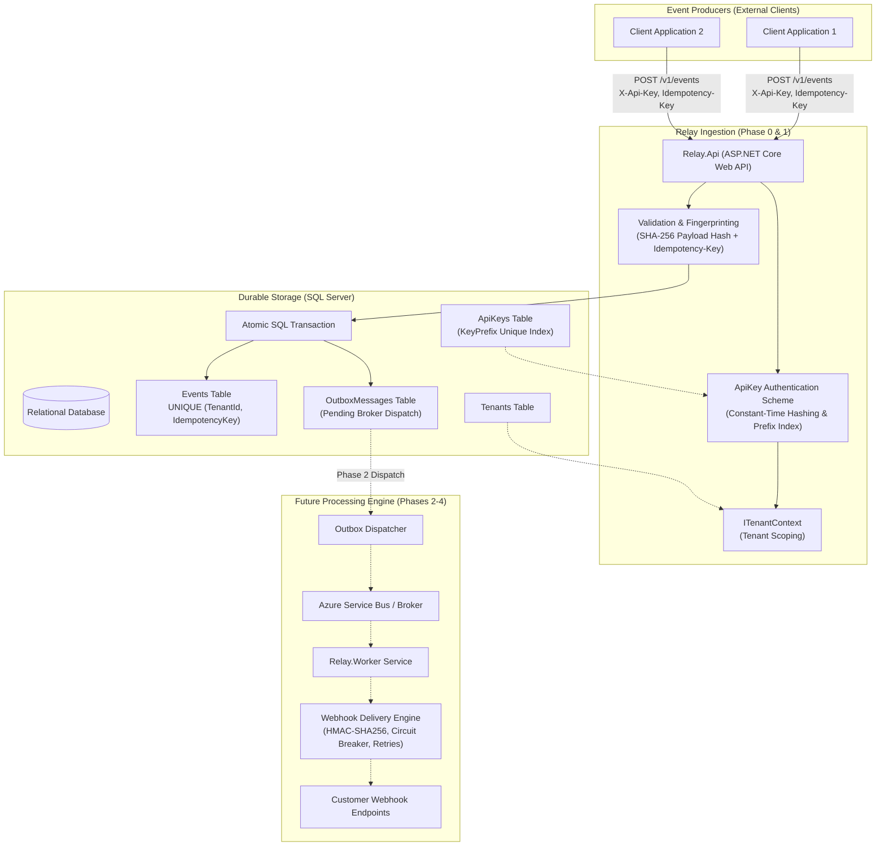

# Relay — System Overview

Relay is a multi-tenant, cloud-native webhook delivery and event management platform. Applications integrate with Relay by submitting events through an authenticated, idempotent REST API. Relay accepts these events, persists them durably inside a relational store alongside a Transactional Outbox record, and eventually dispatches and delivers them to registered customer webhook endpoints with at-least-once delivery semantics.

---

## 1. Core Principles and Delivery Semantics

1. **Durable Ingestion & At-Least-Once Delivery**:
   Relay guarantees durable acceptance and at-least-once delivery attempts. It does not promise unrealistic exactly-once delivery across distributed networks to arbitrary external HTTP destinations. Downstream webhook consumers must design their receiver handlers to be idempotent.

2. **Strict Multi-Tenant Isolation**:
   Every entity, query, idempotency key, and API key is strictly scoped to a `TenantId`. Cross-tenant data leakage is prevented at both the application abstraction level (`ITenantContext`) and via direct query filters (`WHERE TenantId = @tenantId`).

3. **Strong Idempotency**:
   Duplicate event submissions within a tenant are handled safely and deterministically using a unique constraint `(TenantId, IdempotencyKey)` enforced directly in SQL Server. An idempotency violation with identical payload fingerprint returns the original event with HTTP 202; conflicting payloads with the same key return HTTP 409 Conflict.

4. **Atomic Transactional Outbox**:
   To prevent the classic dual-write distributed failure scenario between SQL persistence and message publishing, the Event and its corresponding pending Outbox record are persisted within the exact same database transaction.

---

## 2. Project Architecture

The solution follows clean architecture separation of concerns organized as a modular monolith:

| Project | Responsibility | Dependencies |
| :--- | :--- | :--- |
| `Relay.Domain` | Entities (`Tenant`, `ApiKey`, `Event`, `OutboxMessage`), domain enums, domain rules, validation primitives | None (Zero framework dependencies) |
| `Relay.Application` | Use cases, DTOs, interface abstractions (`IRelayDbContext`, `ITenantContext`, `IApiKeyHasher`), validators, idempotency business logic | `Relay.Domain` |
| `Relay.Infrastructure` | EF Core `RelayDbContext`, Fluent API mappings, migrations, cryptographic key hashing, SQL Server execution | `Relay.Application`, `Relay.Domain`, EF Core, Microsoft.Data.SqlClient |
| `Relay.Api` | ASP.NET Core controllers, `ApiKeyAuthenticationHandler`, middleware (ProblemDetails), Swagger/OpenAPI, health checks | `Relay.Infrastructure`, `Relay.Application`, `Relay.Domain` |
| `Relay.Worker` | Background service host for future message broker consumption and webhook dispatch | `Relay.Infrastructure`, `Relay.Application` |
| `Relay.UnitTests` | Fast, isolated unit tests for hashing, validation, domain entities, and idempotency logic | `Relay.Domain`, `Relay.Application` |
| `Relay.IntegrationTests` | End-to-end integration tests using `WebApplicationFactory` and real SQL Server instances | `Relay.Api`, `Relay.Infrastructure` |
| `relay-dashboard` | React, TypeScript, and Vite developer console for submitting events, testing idempotency, and inspecting delivery logs | None (Consumes REST API via HTTP) |

---

## 3. Phase 1 Implementation Scope

The initial milestone establishes the end-to-end ingestion pipeline:
1. Producer authenticates using `X-Api-Key: rl_live_<prefix>_<secret>`.
2. Controller accepts `POST /v1/events` with `Idempotency-Key` header and payload up to 32 KB.
3. System computes SHA-256 payload hash and initiates an EF Core transaction.
4. Database atomically persists the `Event` entity and the `OutboxMessage` entity.
5. On commit, HTTP 202 Accepted is returned with a `Location: /v1/events/{id}` header and response body.
6. The event can be fetched via `GET /v1/events/{id}` or listed via `GET /v1/events`.
7. React developer console allows testing these operations with in-memory key state and interactive feedback.
